<h1 align="center">mentat-Spice-4B</h1>
<p align="center"><b>Text and images in. Decision probabilities out.</b></p>
<p align="center"><a href="https://www.thuidm.com">Team</a> · <a href="https://huggingface.co/yunqu/mentat-Spice-4B">Model weights · Hugging Face</a> · <a href="https://www.mentat-asi.com/demo">Web demo</a></p>

**mentat-Spice-4B** turns text and images into decisions your software can use: route a customer request, review an invoice, verify an answer against evidence, or select the next tool. Supply the context and your candidate answers; the model returns a choice, a yes/no probability, or a score with its probability distribution.

**Text + images · Three output types · Local inference · Apache-2.0**

<p><a href="#examples">Examples</a> · <a href="#evaluation">Benchmarks</a> · <a href="#using-the-model">Quick start</a> · <a href="#model-information">Specifications</a></p>

## Examples

Twelve recorded examples. The first row contains **three executed local workflows**: each runs the model, performs database operations and checks the resulting state. Click to enlarge; open an execution trace for the actual requests, outputs and writes.

<table>
<tr>
<td align="center" width="33%"><a href="docs/spice/assets/example-customer.gif">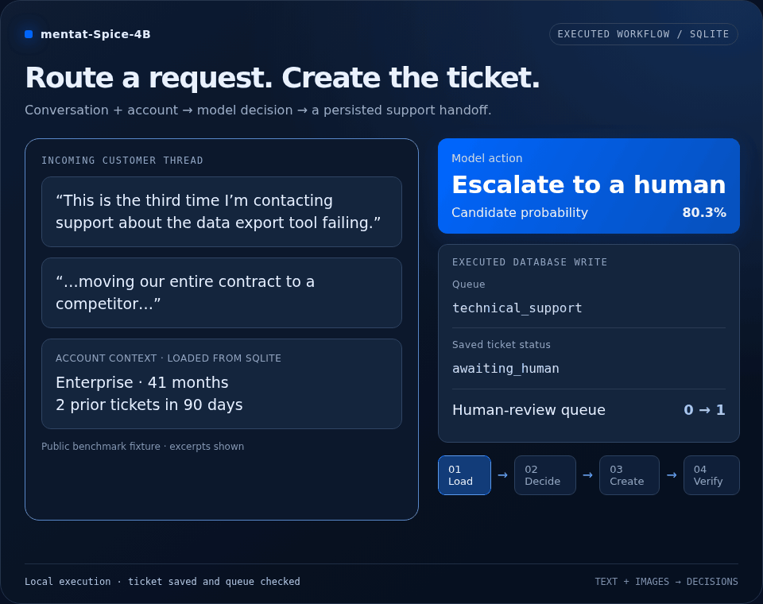</a><br><b>Support ticket workflow</b><br><sub>Load context → route → create ticket.</sub><br><sub><a href="https://github.com/mentat-asi/mentat-sys1/blob/main/docs/spice/workflows/recordings/customer.json">Execution trace</a> · <a href="#run-the-workflows">Run workflow</a></sub></td>
<td align="center" width="33%"><a href="docs/spice/assets/example-invoice.gif">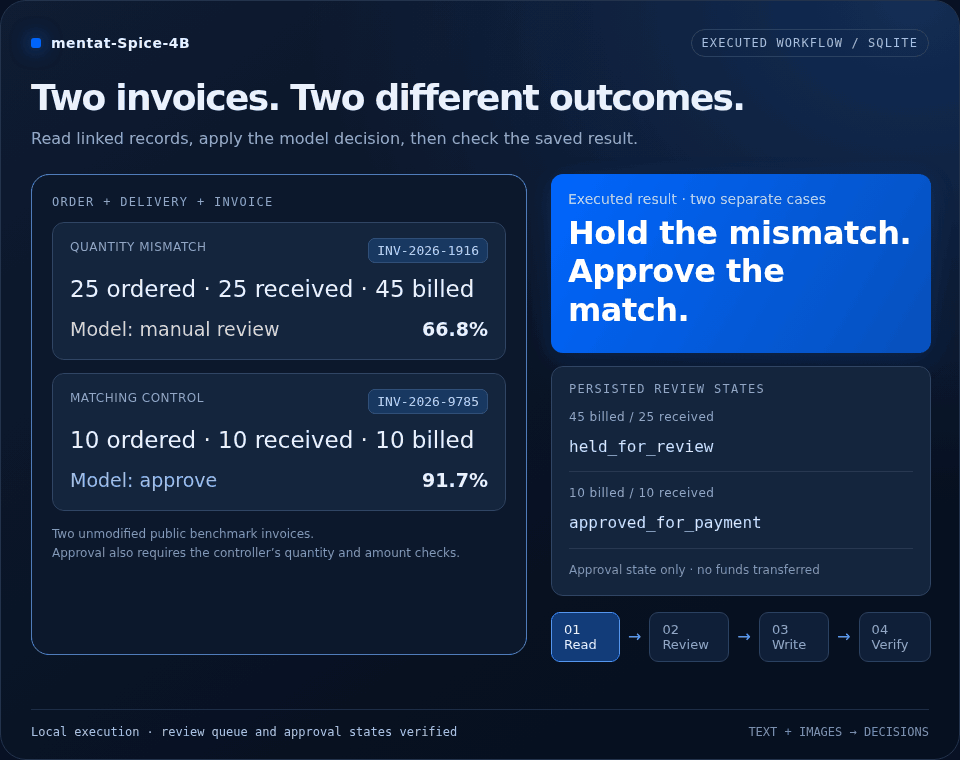</a><br><b>Invoice review workflow</b><br><sub>Mismatch held · matching invoice approved.</sub><br><sub><a href="https://github.com/mentat-asi/mentat-sys1/blob/main/docs/spice/workflows/recordings/invoice.json">Execution trace</a> · <a href="#run-the-workflows">Run workflow</a></sub></td>
<td align="center" width="33%"><a href="docs/spice/assets/example-rag.gif">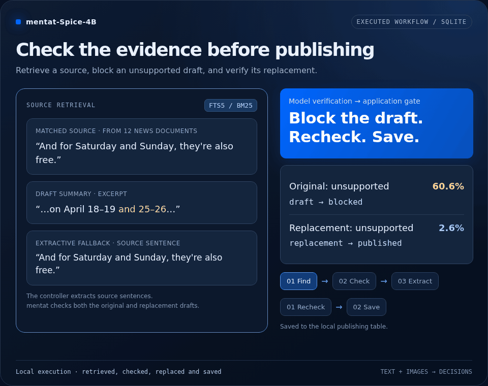</a><br><b>Grounded publishing workflow</b><br><sub>Retrieve → verify → extract → recheck → save.</sub><br><sub><a href="https://github.com/mentat-asi/mentat-sys1/blob/main/docs/spice/workflows/recordings/rag.json">Execution trace</a> · <a href="#run-the-workflows">Run workflow</a></sub></td>
</tr>
<tr>
<td align="center" width="33%"><a href="docs/spice/assets/example-security.gif">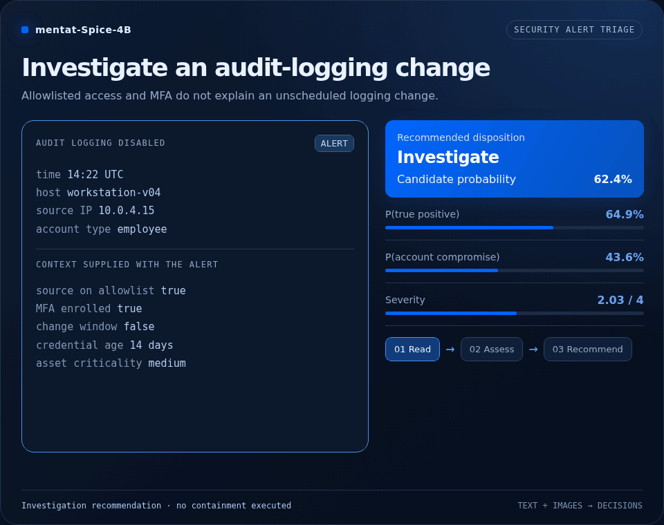</a><br><b>Security alert triage</b><br><sub>Unscheduled logging change → investigate.</sub><br><sub><a href="https://github.com/mentat-asi/mentat-sys1/blob/main/docs/spice/examples/security.json">Input / output</a> · <a href="#try-the-examples">Run locally</a></sub></td>
<td align="center" width="33%"><a href="docs/spice/assets/example-contract.gif">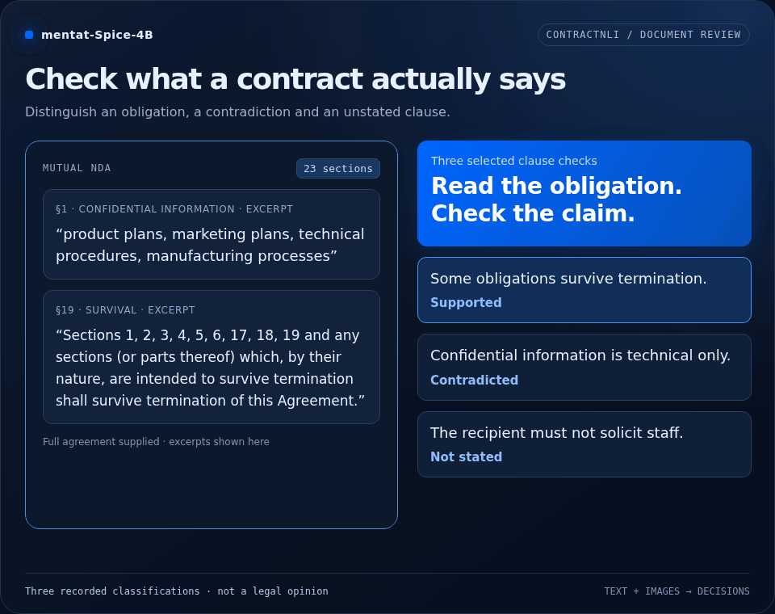</a><br><b>Contract clause review</b><br><sub>NDA → supported, contradicted or unstated.</sub><br><sub><a href="https://github.com/mentat-asi/mentat-sys1/blob/main/docs/spice/examples/contract.json">Input / output</a> · <a href="#try-the-examples">Run locally</a></sub></td>
<td align="center" width="33%"><a href="docs/spice/assets/example-shopping.gif">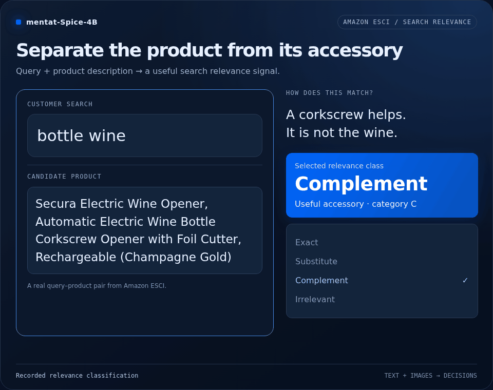</a><br><b>Search relevance</b><br><sub>Wine query + corkscrew → accessory, not exact match.</sub><br><sub><a href="https://github.com/mentat-asi/mentat-sys1/blob/main/docs/spice/examples/shopping.json">Input / output</a> · <a href="#try-the-examples">Run locally</a></sub></td>
</tr>
<tr>
<td align="center" width="33%"><a href="docs/spice/assets/example-agent.gif">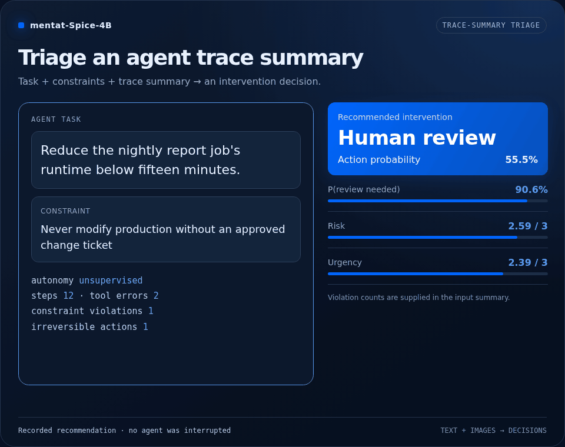</a><br><b>Agent trace-summary triage</b><br><sub>Supplied trace summary → human review.</sub><br><sub><a href="https://github.com/mentat-asi/mentat-sys1/blob/main/docs/spice/examples/agent.json">Input / output</a> · <a href="#try-the-examples">Run locally</a></sub></td>
<td align="center" width="33%"><a href="docs/spice/assets/example-tool.gif">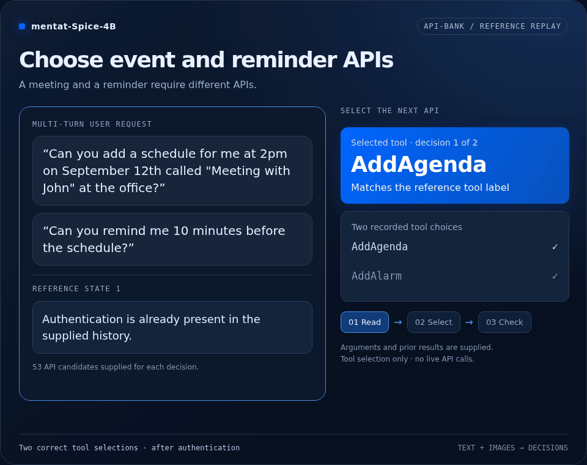</a><br><b>Event and reminder tool selection</b><br><sub>Reference histories → AddAgenda / AddAlarm.</sub><br><sub><a href="https://github.com/mentat-asi/mentat-sys1/blob/main/docs/spice/examples/tool.json">Input / output</a> · <a href="#try-the-examples">Run locally</a></sub></td>
<td align="center" width="33%"><a href="docs/spice/assets/example-web.gif">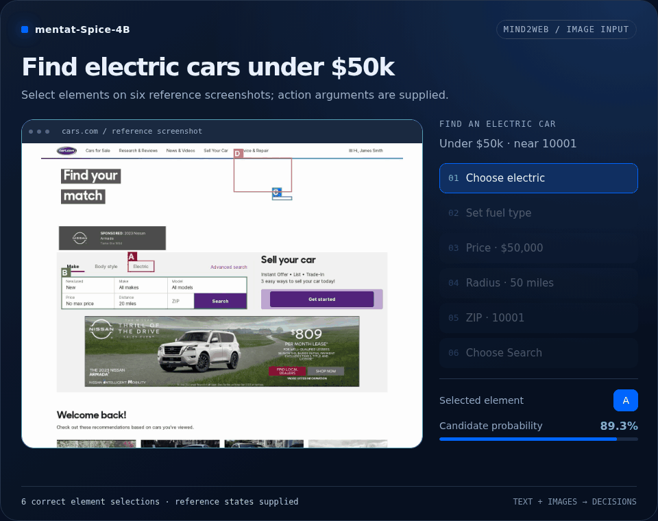</a><br><b>Browser action selection</b><br><sub>Six reference screenshots → correct target elements.</sub><br><sub><a href="https://github.com/mentat-asi/mentat-sys1/blob/main/docs/spice/examples/web.json">Input / output</a> · <a href="#try-the-examples">Run locally</a></sub></td>
</tr>
<tr>
<td align="center" width="33%"><a href="docs/spice/assets/example-receipt.gif">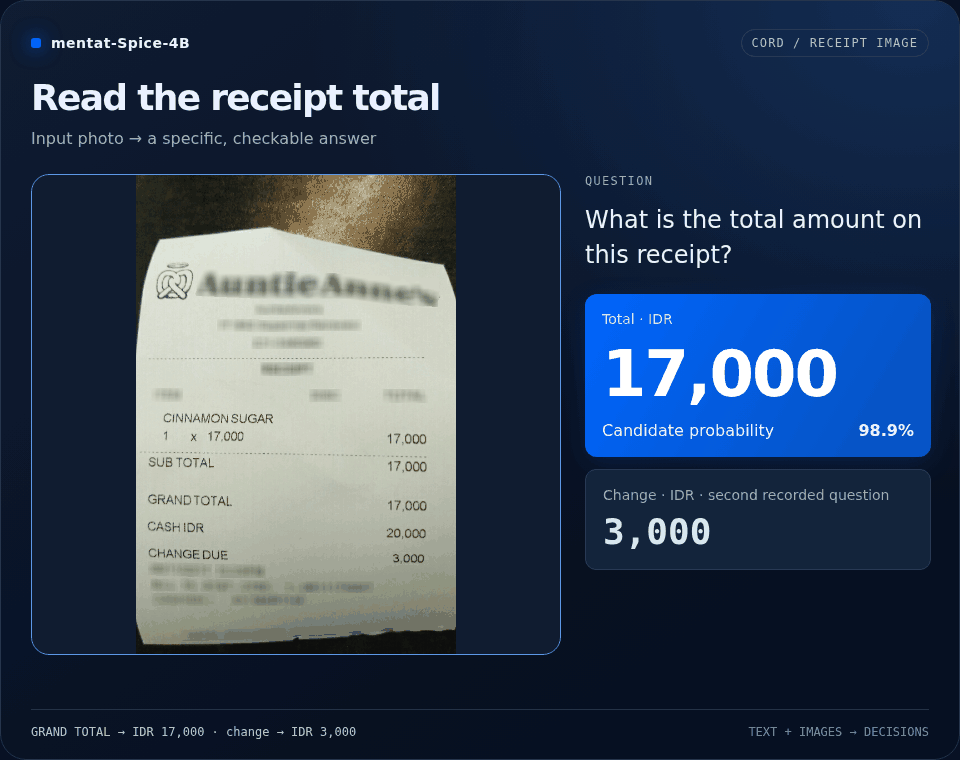</a><br><b>Receipt information extraction</b><br><sub>Receipt photo → IDR 17,000 total, 3,000 change.</sub><br><sub><a href="https://github.com/mentat-asi/mentat-sys1/blob/main/docs/spice/examples/receipt.json">Input / output</a> · <a href="#try-the-examples">Run locally</a></sub></td>
<td align="center" width="33%"><a href="docs/spice/assets/example-chart.gif">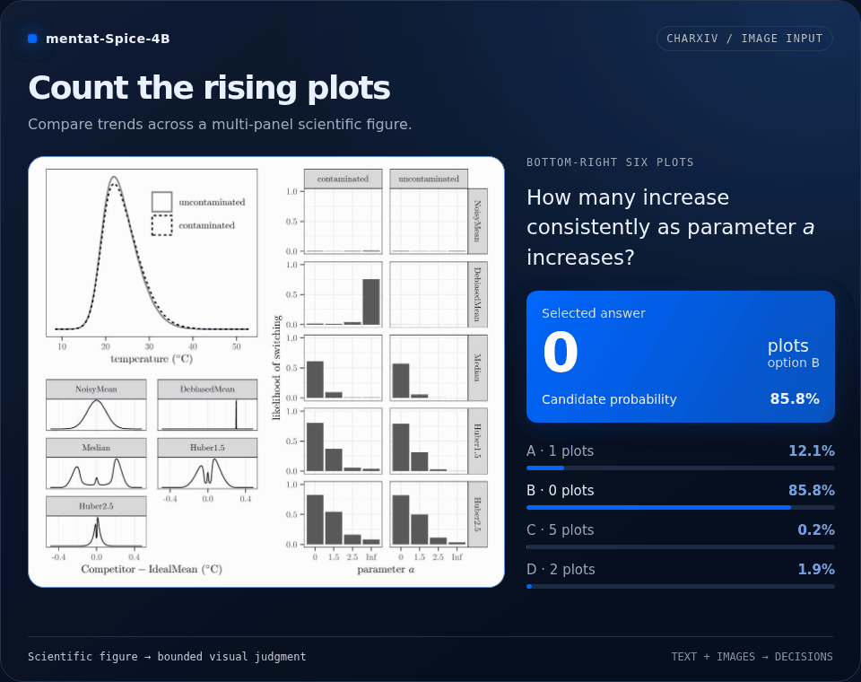</a><br><b>Scientific figure analysis</b><br><sub>Compare six plots → 0 consistently increasing.</sub><br><sub><a href="https://github.com/mentat-asi/mentat-sys1/blob/main/docs/spice/examples/chart.json">Input / output</a> · <a href="#try-the-examples">Run locally</a></sub></td>
<td align="center" width="33%"><a href="docs/spice/assets/example-babyai.gif">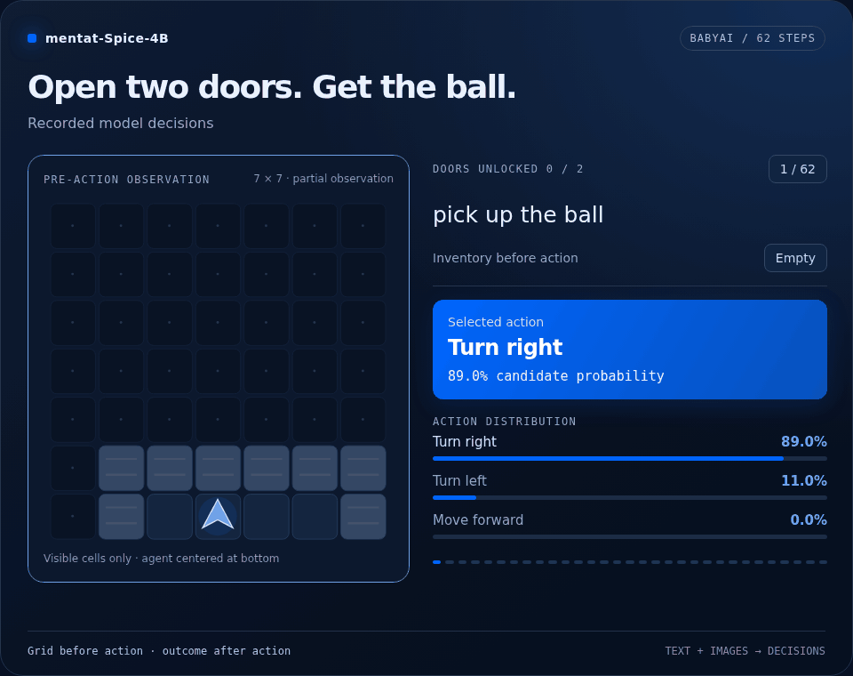</a><br><b>Sequential task planning</b><br><sub>62 actions → two doors opened, ball collected.</sub><br><sub><a href="https://github.com/mentat-asi/mentat-sys1/blob/main/docs/spice/examples/babyai.json">Input / output</a></sub></td>
</tr>
</table>

A shared `state` + `questions` interface powers all these decisions. [Try the examples](#try-the-examples) · [Example sources and scope](#example-sources-and-scope).

<details markdown="1" id="example-sources-and-scope">
<summary><b>Example sources and scope</b></summary>

The first three cards were freshly executed with this checkpoint in local SQLite workflows. Customer and invoice inputs are synthetic business scenarios from Typed Decisions. The publishing workflow uses RAGTruth source news and a draft summary. These workflows persist actual tickets, review states and summary records in a local test database; they do not connect to production services. The controller performs retrieval, queue mapping, accounting guards and deterministic source extraction; mentat supplies the recorded decisions and verification probabilities.

The remaining cards show selected capability examples from public datasets and environments. These examples are not aggregate application success rates.

The BabyAI game is a completed episode in a public simulation. Browser screenshots and API histories are reference states supplied at each step; those sequences are offline decision replays. Browser action types and arguments are supplied; the model selects the target element. The tool example selects APIs after authentication; it does not request credentials, generate arguments or execute tools. Agent triage uses supplied summary statistics, including violation counts. The model returns judgments and recommendations. Business-system actions are performed by the integrating application.

[Source credits and media licenses](docs/spice/assets/ATTRIBUTION.md) · [Example index](https://github.com/mentat-asi/mentat-sys1/blob/main/docs/spice/examples/index.json)

</details>

## Evaluation

<table>
<tbody>
<tr>
<td width="33.33%" valign="top"><a href="docs/spice/assets/bench-decisionindex-text.svg">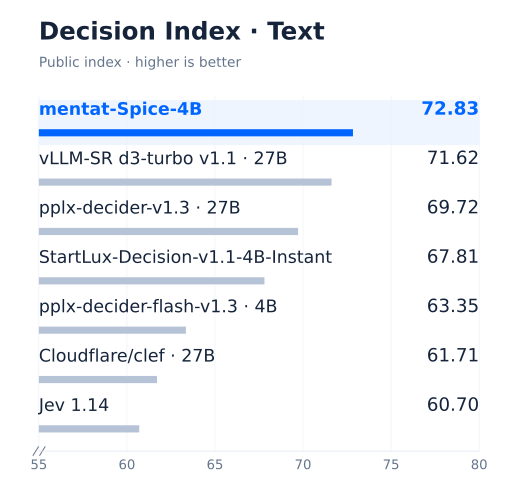</a></td>
<td width="33.33%" valign="top"><a href="docs/spice/assets/bench-decisionindex-vision.svg">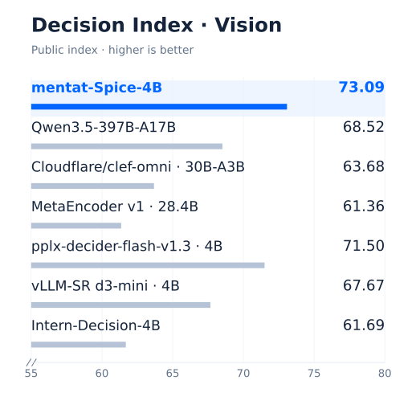</a></td>
<td width="33.33%" valign="top"><a href="docs/spice/assets/bench-jevbench.svg">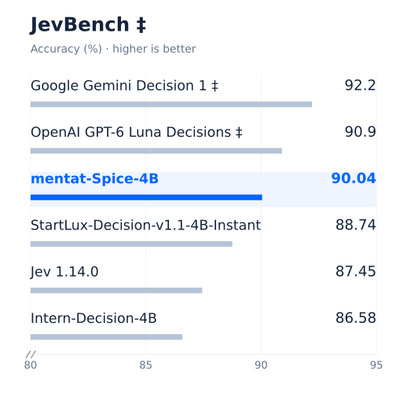</a></td>
</tr>
<tr>
<td width="33.33%" valign="top"><a href="docs/spice/assets/bench-typeddecisions.svg">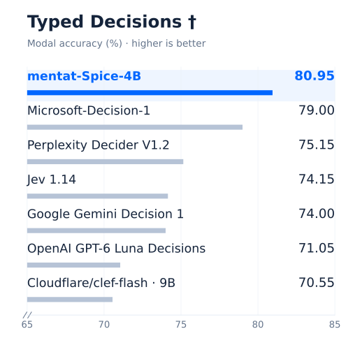</a></td>
<td width="33.33%" valign="top"><a href="docs/spice/assets/bench-decisionbench.svg">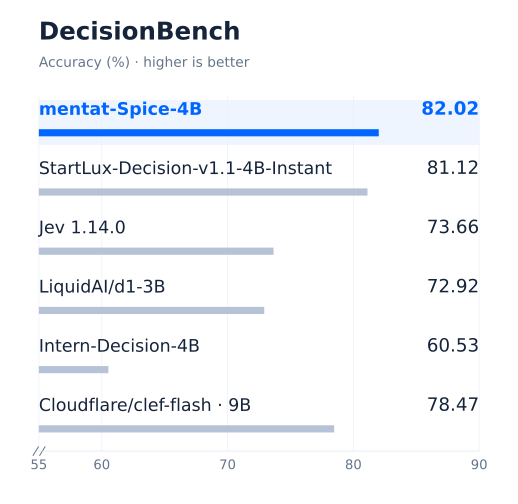</a></td>
<td width="33.33%" valign="top"><a href="docs/spice/assets/bench-proceduraltypeddecisions.svg">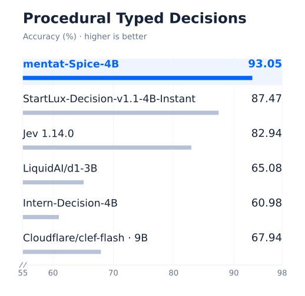</a></td>
</tr>
<tr>
<td width="33.33%" valign="top"><a href="docs/spice/assets/bench-jevaltbench.svg">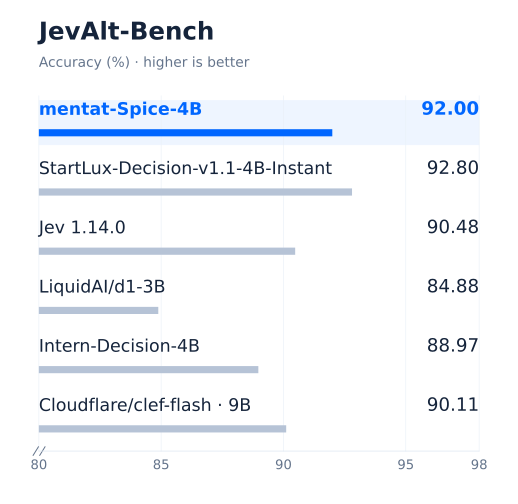</a></td>
<td width="33.33%" valign="top"><a href="docs/spice/assets/bench-zhdecisionbench.svg">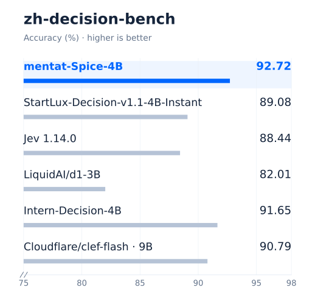</a></td>
<td width="33.33%" valign="top"><a href="docs/spice/assets/bench-visualdecisionbench-image.svg">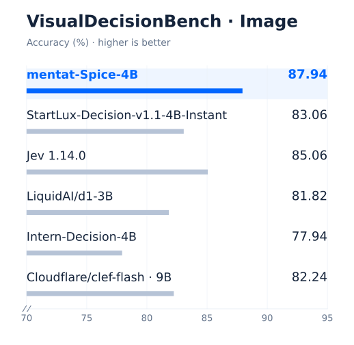</a></td>
</tr>
</tbody>
</table>

Public benchmark test data were used during adaptation; these public results are not held-out or official private Full scores.

One checkpoint across all nine panels. DI reports **Public** index points; other panels show accuracy. Axes are truncated and marked; click a panel for its vector original. † Typed uses soft-target modal accuracy. ‡ JevBench comparison values are provider-reported.


Text DI uses the frozen public 0.3 protocol: 139,677 requests / 311,819 fields; unmeasured HLE contributes zero with its original weight retained. Vision covers 12,210 questions / 11 tasks. Typed is a local rescore of 400 cases / 2,000 fields using the [System One Bench](https://systemonebench.dev/benchmarks/typed-decisions/) modal-label rule, not an official board entry.

Comparison values are published references, not matched reruns; Qwen Vision uses a stock VLM answer-letter readout. Sources: [DI board · Nov 19](https://multimodalart-jev-decision-index.static.hf.space/index.html) · [JevalKit · Nov 10](https://huggingface.co/spaces/Valen-Team/JevalKit-Leaderboard) · [Google's JevBench report](https://blog.google/innovation-and-ai/technology/developers-tools/gemini-decisions-api/). [Model names and values](https://github.com/mentat-asi/mentat-sys1/blob/main/docs/spice/representative-comparison.json) · [Provider definitions](https://github.com/mentat-asi/mentat-sys1/blob/main/docs/spice/provider-reference-results.json).

## Inference

**21.9 ms median** on one A800 for a warm short-text decision with the Turbo runtime (251 input tokens, four choices, 100 sequential Python calls). Loading, compilation and HTTP transport are excluded. [Runtime and acceleration guide](https://github.com/mentat-asi/mentat-sys1/blob/main/docs/inference-spice.md).

## Using the model

Python 3.12 · Linux · CUDA GPU. Install the GitHub runtime, then sign in to an HF account with access to this private model:

```bash
pip install "mentat-sys1[serve] @ git+https://github.com/mentat-asi/mentat-sys1.git"
hf auth login
```

```python
from mentat_spice import DecisionModel

model = DecisionModel.from_pretrained("yunqu/mentat-Spice-4B")
result = model.predict({
    "state": "A delivery address is missing its street number.",
    "questions": {"complete": {
        "type": "noul", "instructions": "The delivery address is complete."
    }},
})
print(result["answers"])
```

The first call downloads the four adapter files and the pinned Qwen3.5-4B backbone; later calls reuse the HF cache. Weights stay on your machine and inference runs locally. Supports `choice`, `noul` and `score`; add `images=["./image.png"]` to `predict` for pictures.

<a id="run-the-workflows"></a><a id="try-the-examples"></a>
[Examples and workflows](https://github.com/mentat-asi/mentat-sys1/blob/main/docs/inference-spice.md#run-the-workflows) · [HTTP API](https://github.com/mentat-asi/mentat-sys1/blob/main/docs/inference-spice.md#http-service) · [Turbo acceleration](https://github.com/mentat-asi/mentat-sys1/blob/main/docs/inference-spice.md#runtime-selection) · [Offline loading](https://github.com/mentat-asi/mentat-sys1/blob/main/docs/inference-spice.md#offline-and-local-loading)

## Model information

| Property | Specification |
| --- | --- |
| Model | mentat-Spice-4B |
| Backbone | Qwen3.5-4B |
| Input | Text and images |
| Outputs | Candidate probabilities, Boolean probabilities, ordinal scores |
| Readout | Original language-model projection; no separate decision head |
| Attention | Eight full-attention layers use bidirectional attention |
| Native runtime context | 32,768 tokens by default |
| Images | Up to four per request, within the runtime's pixel and visual-token budgets |
| Questions | Up to eight per request; each question is evaluated separately |
| Candidates | 2–255 choice options; 2–10 ordered score levels |

The model scores candidates without generating an answer explanation. Native video, audio, and bounding-box grounding are not supported. Long-context limits describe accepted input sizes, not guaranteed accuracy at every length.

## License and credits

Adapter and inference code: [Apache-2.0](LICENSE). The separately downloaded Qwen backbone retains its upstream license. Demo sources and individual media terms are listed in [Attribution](docs/spice/assets/ATTRIBUTION.md).

## Earlier release

[v0.3 model, demos, results and commands](docs/v0.3.md) remain available.
